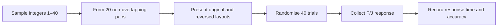

# Numerical Magnitude Comparison Task

A compact PsychoPy experiment implementing a two-choice numerical magnitude judgment task. Each participant completes 40 trials: 20 randomly formed number pairs, each presented in both left–right configurations.

## Task design



The task:

- Samples integers 1–40 and forms 20 non-overlapping pairs.
- Presents each pair in its original and reversed left–right configuration.
- Randomises trial order.
- Collects responses using **F** (left number larger) and **J** (right number larger).
- Records one structured row per trial, including stimulus values, response, correct response, reaction time, and accuracy.

## Implementation

- **Language:** Python
- **Framework:** PsychoPy
- **Main script:** `numerical_magnitude_task.py`

```bash
pip install psychopy numpy pandas
python numerical_magnitude_task.py
```

## Run and output

The task opens a PsychoPy window and waits for Enter before beginning. Trial-level results are saved to `results.csv` in the script directory.

## Scope

This is a focused experimental implementation rather than a packaged application. It demonstrates stimulus generation, counterbalanced left–right presentation, response collection, reaction-time measurement, accuracy scoring, and structured data export.

A formal practice phase, participant metadata dialog, and automated analysis/reporting are not currently included.
